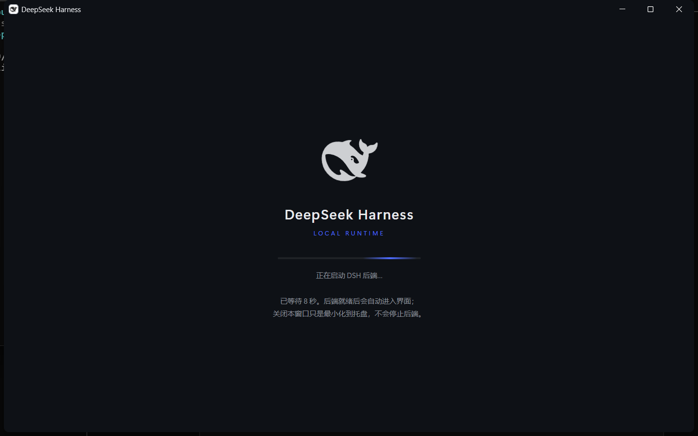
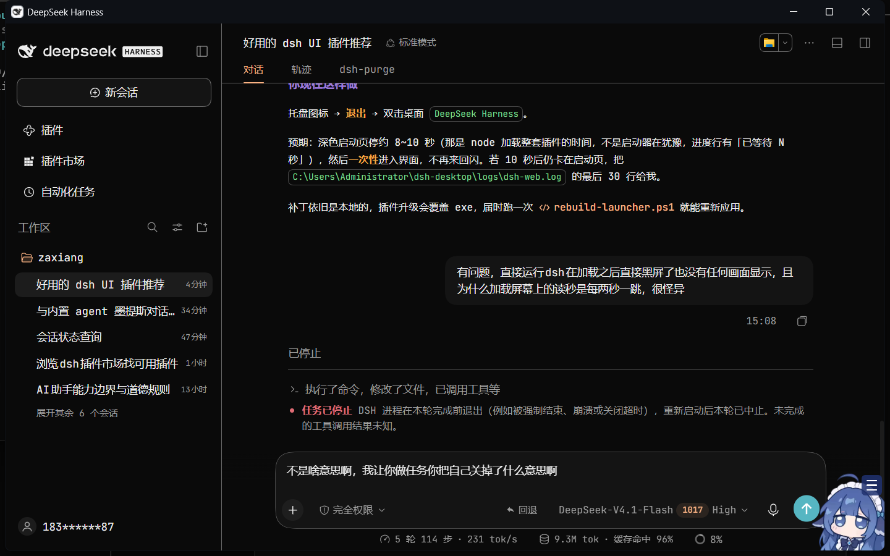

<div align="center">

# dsh-desktop-shell-plus

**给 DeepSeek Harness 的桌面外壳补上它缺的那层皮。**

深色品牌启动页 · 真 DPI 感知 · 深色无边框标题栏 · 窗口位置记忆 · F12 开发者工具 · 右栏 20%

</div>

---

## 这是什么

DeepSeek Harness（下称 dsh）官方只提供 `web` / `tui` / `headless` 三种 profile，没有桌面客户端。社区的
[`dsh-desktop-shell`](https://github.com/RINGOLINK/dsh-desktop-shell) 用 .NET Framework + WebView2 把 Web UI
包成一个原生窗口，思路很对，但它交出来的默认版有三个明显问题：

- **糊**：进程没有 DPI 声明，125% 缩放的屏幕上整个窗口被 Windows 位图拉伸；
- **丑**：启动等待期是一个白底黑字的裸 WinForms 面板，标题栏也是系统浅色，深色界面旁边挂着一条白条；
- **碎**：后端还没起完就反复重导航，会看到「127.0.0.1 拒绝连接」、闪回、以及看门狗把正在启动的后端误杀。

本仓库是这套外壳的**补丁版源码 + 可重复执行的脚本**：不重新发明外壳，只把上面这些按下去，并且让改动在
插件升级之后还能一键重放。

> 这不是 fork 的 npm 包，也不分发任何二进制。仓库里只有一份改过的 `DSHLauncher.cs` 和几个 PowerShell
> 脚本，作用在你自己已经装好的 `dsh-desktop-shell` 上。

## 效果

| 启动页 | 进界面 |
|---|---|
|  |  |

标题栏深色、与内容无缝；启动页是鲸鱼 logo + wordmark + `LOCAL RUNTIME` + 进度条 + 一行状态，没有白闪。

## 改了什么

### 1. 启动器（`src/DSHLauncher.patched.cs`）

| 项 | 默认版 | 本仓库 |
|---|---|---|
| DPI | 无声明，被系统拉伸 | `SetProcessDpiAwarenessContext(-2)` → shcore 1 → `SetProcessDPIAware()` 三级回退 |
| 窗口尺寸 | 固定，可能超出工作区 | 按 `WorkingArea` 计算，上限 1440×900，下限 880×560 |
| 标题栏 | 系统浅色 | DWM 属性 20/19/34/35/36：沉浸深色 + 深色边框 + 标题文字色 `#E8EAED` |
| 等待界面 | 白底黑字 Label | 深色 HTML 启动页（读 `<home>\logo.svg`），236×3 进度条，状态行随启动阶段更新 |
| 错误界面 | 裸文字面板 | 同一个品牌启动页承载错误文案 |
| 窗口记忆 | 每次默认居中 | `<home>\window.json` 记录 x/y/w/h/max，恢复前校验与显示器工作区相交 |
| 开发者工具 | 无入口 | 注入 keydown 桥：`F12` 打开 DevTools，`Ctrl+R` 重载 |
| 导航节奏 | 每 2s 重导航一次 | 单次在飞闸门 + 端口未监听不导航 + 端口监听前 60s 启动宽限 |
| 读秒 | 「已等待 N 秒」跳变 | 已移除，只留静态说明 |

### 2. 右栏宽度（`scripts/patch-rightbar-width.ps1`）

DSH 框架把右侧面板（Git、文件、终端都挂在右栏）的首开宽度写死成**视口的 45%**。脚本改的是
`@deepseek-ai/dsh-client-ui-layout/lib/client.js`：

```js
const RIGHTBAR_DEFAULT_RATIO = .45;   // → .2
const rightbarPreference = layoutInfo.rightbar ?? viewport * .45;   // → * .2
clampWidth(rightbar, 300, viewport * RIGHTBAR_MAX_RATIO)            // → 280
```

改完右栏首开约 20%，拖拽下限也一起降到 280px。

### 3. 快捷方式不再被抢（`scripts/patch-shortcuts.ps1`）

`dsh-desktop-shell` 在后端每次启动后都会重跑 `installDesktop()`：把原版 `DSHLauncher.exe` 复制回去，
并按硬编码的文件名重建快捷方式——你重命名过的链接会被当成「缺失」再建一个。脚本做三件事：

1. 让插件生成的快捷方式脚本**优先指向最新的 `DSHLauncher-custom*.exe`**，没有才回退到原版；
2. 让启动期修复在 `.shortcuts-frozen` 标记存在时**不再创建/改名/改目标**；
3. 落下这个标记文件。

## 要求

- Windows 10/11 x64
- [.NET Framework 4.8](https://dotnet.microsoft.com/download/dotnet-framework/net48)（Win10 22H2 起自带）
- WebView2 Runtime（Edge 自带；`C:\Program Files (x86)\Microsoft\EdgeWebView\Application\*` 存在即可）
- dsh `>= 0.1.5-rc.1`（本仓库在 `0.2.1-rc.2` 上验证）
- 已安装 `dsh-desktop-shell`：`dsh plugin --profile web add dsh-desktop-shell`
- 编译用 legacy csc，不需要装 SDK：`C:\Windows\Microsoft.NET\Framework64\v4.0.30319\csc.exe`

## 用法

```powershell
# 0) 先让插件把 home 目录铺好（装完后端跑一次，或直接调 install 接口）

# 1) 编译补丁启动器 + 把已有快捷方式指过去
powershell -ExecutionPolicy Bypass -File .\scripts\rebuild-launcher.ps1

# 2) 右栏首开 20%
powershell -ExecutionPolicy Bypass -File .\scripts\patch-rightbar-width.ps1

# 3) 冻结快捷方式 + 让插件指向 custom 构建
powershell -ExecutionPolicy Bypass -File .\scripts\patch-shortcuts.ps1
```

然后**重启后端**（托盘 → 退出，再双击快捷方式），浏览器侧改动按 `Ctrl+F5` 强刷。

### 脚本参数

| 脚本 | 说明 |
|---|---|
| `rebuild-launcher.ps1` | `-LauncherHome <路径>` 指定 launcher home（默认 `%USERPROFILE%\dsh-desktop`）；`-NoBuild` 只重指快捷方式不编译；`-Quiet` 静默 |
| `patch-rightbar-width.ps1` | `-DshRoot <路径>` 指定 dsh 安装根，默认在 `%LOCALAPPDATA%\npm-cache\_npx\*\` 里找最新一份 |
| `patch-shortcuts.ps1` | `-ProfileRoot`、`-LauncherHome`，默认 `%USERPROFILE%\.dsh\profiles` 与 `%USERPROFILE%\dsh-desktop` |

三个脚本都**幂等**，重复执行输出 `already patched` 之类的提示，不会重复改。

## 为什么构建文件名带版本号

Windows 不允许覆盖一个正在映射中的 exe 映像，而改外壳的时候启动器通常正开着。所以每次构建产出
`DSHLauncher-custom-v<N>.exe`（`<home>\custom\build-name.txt` 记当前序号），再把快捷方式原地重指到新文件；
没人指向、也没在运行的旧构建会被自动清掉，只留当前和一个前身。

## 已知限制

- **插件升级会覆盖**：`dsh-desktop-shell` 升级会重写 `lib/install.js`、`lib/index.js` 并覆盖
  `DSHLauncher.exe`/`DSHLauncher.cs`。升级后重跑三个脚本即可（源码在 `src/`，不依赖插件里的那份）。
- **dsh 升级会覆盖右栏补丁**：`@deepseek-ai/dsh-client-ui-layout` 在 npx 缓存里，换版本就是新目录，重跑
  `patch-rightbar-width.ps1`。脚本会先做 `RIGHTBAR_DEFAULT_RATIO` 存在性检查，版本变了会明确报错而不是
  乱改。
- 改的是上游文件的本地副本，**升级/重装即失效**，这是这套方案的本质代价；不接受的话应该去上游提 PR。
- 单实例互斥、托盘、就绪门控、令牌捕获这些骨架来自 `dsh-desktop-shell`，本仓库没有重写它们。

## 许可与来源

MIT，见 [LICENSE](LICENSE)。

- `src/DSHLauncher.patched.cs` 与 `src/DSHLauncher.ico` 源自 [RINGOLINK/dsh-desktop-shell](https://github.com/RINGOLINK/dsh-desktop-shell)（MIT），
  在其上做修改；原版权声明保留在 LICENSE 中。
- `scripts/patch-rightbar-width.ps1` 只对 `@deepseek-ai/dsh-client-ui-layout` 的本地安装副本做字符串替换，
  不复制、不分发该包的任何代码；该包版权归 DeepSeek 所有。
- 本仓库不包含 dsh 本体、不包含 WebView2 运行时、不分发任何 exe。

## English

`dsh-desktop-shell-plus` is a patch set for the community WebView2 shell of DeepSeek Harness. dsh ships only
`web` / `tui` / `headless` profiles — there is no official desktop app. This repo fixes what the stock shell gets
wrong on high-DPI Windows: it declares per-monitor DPI awareness, replaces the blank white wait panel with a
dark branded splash, paints the title bar dark via DWM, remembers window bounds, wires `F12` to DevTools, and stops
the launcher from re-navigating while the backend is still booting. Two extra scripts narrow the right-side panel
from 45% to 20% of the viewport and stop the plugin from recreating your renamed shortcuts.

Everything is source + idempotent PowerShell on top of an existing install. No binaries. MIT.
